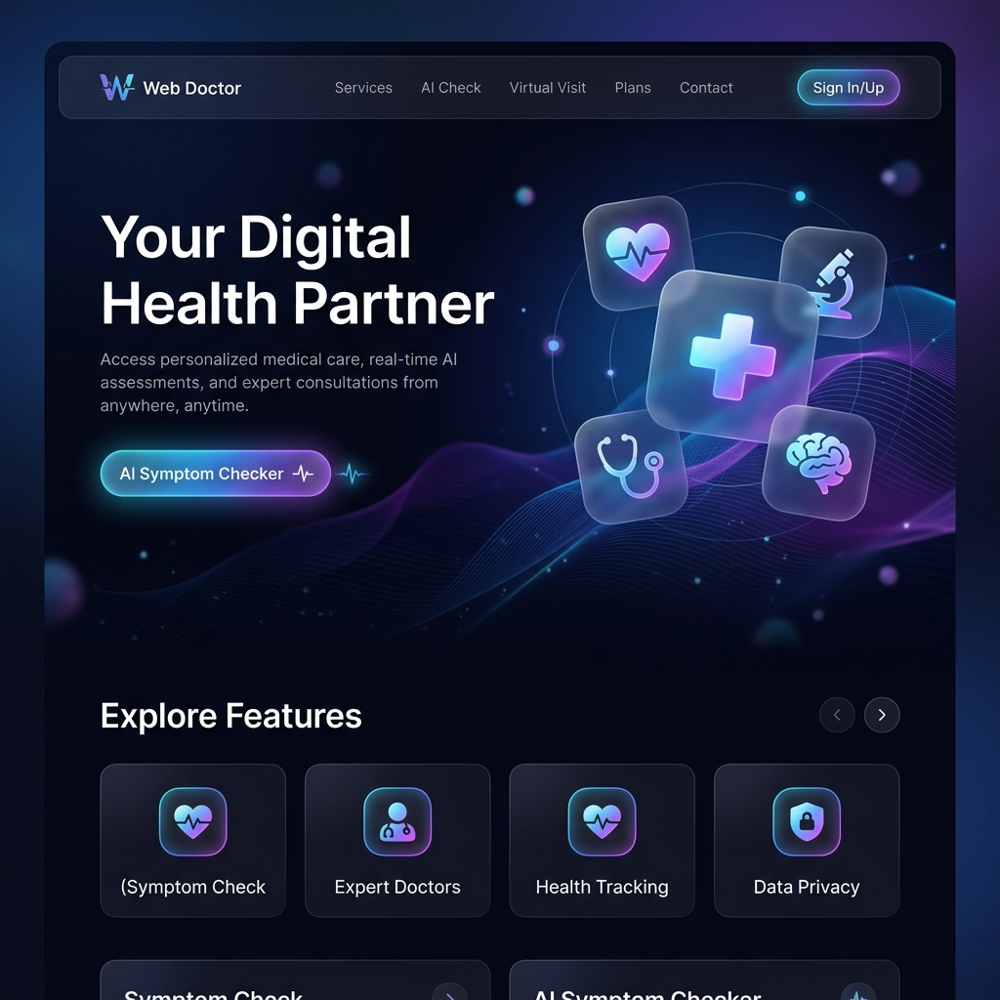

# Web Doctor - AI-Powered Healthcare Platform

A comprehensive full-stack healthcare platform designed for connecting patients with doctors, providing AI-powered symptom analysis, and managing medical appointments across multiple hospitals.



## 🌟 Features

### For Patients
- **AI Symptom Checker**: Get instant medical guidance powered by hybrid ML + rule-based AI
- **Multi-language Support**: English, Hindi, and Hinglish
- **Doctor Discovery**: Browse 11+ specialist doctors across 4 hospitals
- **Appointment Booking**: Book consultations with specialists
- **Real-time Notifications**: Get instant updates on appointment confirmations
- **Health History**: Track your symptom analyses and appointments
- **Hospital Information**: View detailed hospital profiles with locations

### For Doctors
- **Clinical Dashboard**: Manage appointments and patient consultations
- **AI Review System**: Review and validate AI-generated diagnoses
- **Notification System**: Get alerted for new appointments
- **Hospital Integration**: View appointments across your hospital
- **Patient Management**: Access patient symptoms and medical history

### For Hospitals
- **Appointment Visibility**: Track all appointments across hospital doctors
- **Doctor Management**: Manage specialist doctors and their profiles
- **Real-time Updates**: Monitor patient bookings in real-time

## 🏥 Hospital Network

### Indian Hospitals (4 Locations)
1. **Apollo Multispecialty Hospital** - Bangalore
2. **Fortis Healthcare Center** - Chandigarh
3. **Max Super Specialty Hospital** - New Delhi
4. **Manipal Hospital** - Bangalore

### Medical Specialties (11 Specialists)
- Cardiology
- Pediatrics
- Orthopedics
- General Medicine
- Dermatology
- ENT (Ear, Nose, Throat)
- Neurology
- Gastroenterology
- Obstetrics & Gynecology
- Pulmonology
- Ophthalmology

## 🛠️ Technology Stack

### Backend
- **Framework**: FastAPI (Python)
- **Database**: SQLite with SQLAlchemy ORM
- **Authentication**: JWT (JSON Web Tokens)
- **Password Security**: Bcrypt hashing
- **AI/ML**: 
  - Scikit-learn (TF-IDF + Logistic Regression)
  - Transformers (ClinicalBERT support)
  - Custom rule-based medical triage engine
- **API Documentation**: Auto-generated Swagger UI

### Frontend
- **Framework**: React 18
- **Build Tool**: Vite
- **Routing**: React Router v7
- **HTTP Client**: Axios
- **Icons**: Lucide React
- **Styling**: Vanilla CSS with Glassmorphism design

## 📋 Prerequisites

- **Python**: 3.8 or higher
- **Node.js**: 16 or higher
- **npm**: 8 or higher

## 🚀 Installation & Setup

### 1. Clone the Repository
```bash
git clone <repository-url>
cd web-doctor
```

### 2. Backend Setup

```bash
# Navigate to backend directory
cd backend

# Install Python dependencies
pip install -r requirements.txt

# Start the FastAPI server
uvicorn main:app --reload --host 0.0.0.0 --port 8000
```

The backend will be available at: **http://localhost:8000**
- API Documentation: **http://localhost:8000/docs**

### 3. Frontend Setup

```bash
# Navigate to frontend directory (from root)
cd frontend

# Install Node dependencies
npm install

# Start the development server
npm run dev
```

The frontend will be available at: **http://localhost:5173**

## 📁 Project Structure

```
web-doctor/
├── backend/
│   ├── main.py                 # FastAPI application & routes
│   ├── models.py               # SQLAlchemy database models
│   ├── schemas.py              # Pydantic schemas
│   ├── database.py             # Database configuration
│   ├── medical_triage.py       # Rule-based triage engine
│   ├── nlp_pipeline.py         # Hybrid AI pipeline
│   ├── requirements.txt        # Python dependencies
│   ├── webdoctor.db           # SQLite database (auto-generated)
│   └── ml/
│       ├── train_triage_model.py
│       ├── prepare_mimic_style_dataset.py
│       ├── artifacts/          # Trained ML models
│       └── data/              # Training datasets
│
└── frontend/
    ├── src/
    │   ├── App.jsx            # Main application component
    │   ├── main.jsx           # Entry point
    │   ├── components/
    │   │   └── Navbar.jsx     # Navigation with notifications
    │   └── pages/
    │       ├── LandingPage.jsx
    │       ├── Auth.jsx       # Login/Register
    │       ├── PatientDashboard.jsx
    │       ├── DoctorDashboard.jsx
    │       └── Hospitals.jsx  # Hospital directory
    ├── package.json
    └── vite.config.js
```

## 🔐 Default Test Accounts

### Doctors (Login: email / password)
```
dr.sharma@apollo.com / doctor123       - Cardiologist, Apollo Hospital
dr.priya@apollo.com / doctor123        - Pediatrician, Apollo Hospital
dr.singh@fortis.com / doctor123        - General Medicine, Fortis
dr.reddy@fortis.com / doctor123        - Dermatologist, Fortis
dr.gupta@maxhealthcare.com / doctor123 - Neurologist, Max Hospital
dr.iyer@manipal.com / doctor123        - OB/GYN, Manipal Hospital
```

### Patients
Register your own account at: http://localhost:5173/register

## 🎯 Key Features Explained

### 1. AI Symptom Analysis
- **Hybrid Model**: Combines ML (TF-IDF + Logistic Regression) with rule-based engine
- **Multi-language**: Supports English, Hindi, and Hinglish
- **Severity Detection**: Classifies as Emergency, High, Moderate, or Low
- **Specialist Recommendation**: Suggests appropriate medical specialist
- **First-aid Guidance**: Provides immediate care instructions
- **Audit Trail**: All analyses are logged for doctor review

### 2. Notification System
- **Real-time Updates**: Bell icon shows unread notification count
- **Auto-refresh**: Polls for new notifications every 30 seconds
- **Appointment Alerts**: 
  - Doctors notified of new bookings
  - Patients receive confirmation
- **Read/Unread Status**: Visual indicators for notification status
- **Dropdown Interface**: Clean, accessible notification panel

### 3. Hospital Management
- **Appointment Visibility**: View all appointments per hospital
- **Doctor Profiles**: Complete specialist information
- **Contact Details**: Phone, email, and address
- **Real-time Updates**: See bookings as they happen

### 4. Security Features
- **JWT Authentication**: Secure token-based auth
- **Password Hashing**: Bcrypt with salt
- **Role-based Access**: Patient vs Doctor permissions
- **Protected Routes**: Frontend and backend route guards

## 📊 Database Schema

### Main Tables
- **users**: User accounts (patients & doctors)
- **doctors**: Doctor profiles with specialties
- **hospitals**: Hospital information
- **appointments**: Booking records
- **notifications**: User notifications
- **analysis_audits**: AI symptom analysis logs
- **clinician_reviews**: Doctor reviews of AI analyses

## 🔧 API Endpoints

### Authentication
- `POST /register` - Create new account
- `POST /token` - Login and get JWT token
- `GET /me` - Get current user info

### Appointments
- `POST /appointments` - Book appointment
- `GET /appointments` - Get user appointments
- `GET /hospitals/{id}/appointments` - Get hospital appointments

### Doctors & Hospitals
- `GET /doctors` - List all doctors
- `GET /hospitals` - List all hospitals

### AI Analysis
- `POST /ai/analyze` - Analyze symptoms
- `GET /ai/model-info` - Get AI model information
- `GET /ai/audits/me` - Get user's analysis history
- `GET /ai/reviews/pending` - Get pending reviews (doctors)
- `POST /ai/reviews/{id}` - Submit review (doctors)

### Notifications
- `GET /notifications` - Get all notifications
- `GET /notifications/unread/count` - Get unread count
- `PUT /notifications/{id}/read` - Mark as read

## 🎨 UI/UX Features

- **Glassmorphism Design**: Modern translucent UI elements
- **Responsive Layout**: Works on mobile and desktop
- **Interactive States**: Smooth hover effects and transitions
- **Loading States**: Visual feedback during operations
- **Error Handling**: User-friendly error messages
- **Gradient Backgrounds**: Eye-catching color schemes
- **Icon System**: Lucide React icons throughout

## 🧪 Testing the Application

### 1. Test Symptom Analysis
```
1. Go to http://localhost:5173
2. Click "Get Started" or navigate to Dashboard
3. Enter symptoms: "fever and headache"
4. Click "Analyze Symptoms"
5. View AI-generated diagnosis and recommendations
```

### 2. Test Appointment Booking
```
1. Login as patient
2. Go to Dashboard
3. Browse available doctors
4. Click "Book Appointment" on any doctor
5. Check notification bell (should show "1")
6. View appointment in "My Appointments"
```

### 3. Test Doctor Notifications
```
1. Logout
2. Login as doctor (dr.sharma@apollo.com / doctor123)
3. Check notification bell
4. See "New Appointment Booked" notification
5. View appointment in dashboard
```

### 4. Test Hospital View
```
1. Go to "Hospitals" page
2. Click on any hospital
3. View doctors working there
4. Scroll down to see "Recent Appointments"
5. See all bookings for that hospital
```

## 🔄 Development Workflow

### Backend Development
```bash
cd backend
# Make changes to Python files
# Server auto-reloads with --reload flag
```

### Frontend Development
```bash
cd frontend
# Make changes to React components
# Vite HMR updates instantly
```

### Database Reset
```bash
# Stop backend server
# Delete webdoctor.db
# Restart server (auto-creates fresh DB with seed data)
```

## 📝 Environment Variables

### Backend (Optional)
```python
SECRET_KEY = "your-secret-key"  # Change in production
ALGORITHM = "HS256"
ACCESS_TOKEN_EXPIRE_MINUTES = 30
```

### Frontend (Optional)
```javascript
VITE_API_URL = "http://localhost:8000"  # API base URL
```

## 🚨 Important Notes

### Medical Disclaimer
- This is a **demonstration project** for educational purposes
- AI guidance is **not a substitute** for professional medical advice
- For emergencies, always call local emergency services (108 in India)
- Consult qualified healthcare professionals for medical decisions

### Security Notes
- Change `SECRET_KEY` in production
- Use HTTPS in production
- Implement rate limiting for API endpoints
- Add CORS restrictions for production domains
- Use environment variables for sensitive data

## 🤝 Contributing

This is a BCA final year project. For improvements or bug reports, please contact the development team.

## 📄 License

This project is created for educational purposes as part of a BCA final year project.

## 👥 Credits

- **AI Models**: Scikit-learn, Transformers
- **Medical Data**: MIMIC-style clinical datasets
- **Icons**: Lucide React
- **UI Inspiration**: Modern healthcare platforms

## 📞 Support

For issues or questions:
1. Check the API documentation at http://localhost:8000/docs
2. Review the console logs for errors
3. Ensure all dependencies are installed correctly

---

**Built with ❤️ for better healthcare accessibility**
